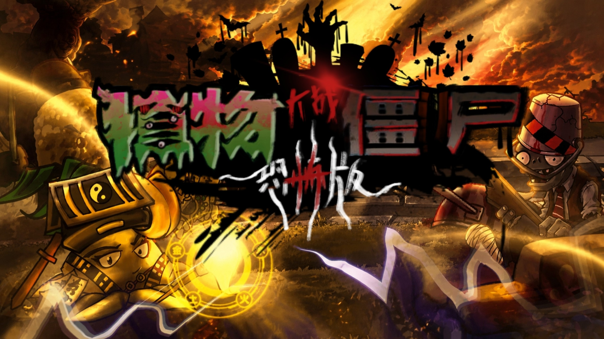

# PVZ Scared — 植物大战僵尸恐怖版



**PVZ Scared** é uma versão de terror feita por fãs de *Plants vs. Zombies*. A defesa do jardim continua sendo o centro do jogo, mas plantas, zumbis, sons e cenários ganham uma aparência sombria. A história aparece em entradas de diário ao longo das fases. O projeto é chinês e não é uma versão oficial da PopCap ou da EA.

Este repositório contém a **versão 1.0.1 para Windows**, já compilada em Unity. Não há código-fonte nem um projeto Unity editável aqui.

## Como executar

1. No Windows de 64 bits, mantenha a pasta `PVZ-Scared-1.0.1` inteira, sem separar o executável dos outros arquivos.
2. Abra `PVZ-Scared-1.0.1/PVZ-Scared.exe` com um duplo clique. Se preferir o PowerShell, execute a partir da raiz deste repositório:

   ```powershell
   .\PVZ-Scared-1.0.1\PVZ-Scared.exe
   ```

3. No jogo, avance pelas fases e leia as entradas do diário para acompanhar a história. A interface e os textos desta cópia estão em chinês.

O executável precisa continuar ao lado de `GameAssembly.dll`, `UnityPlayer.dll` e da pasta `PVZ-Scared_Data`. Esta cópia é um jogo independente: não é necessário colocá-la na pasta do *Plants vs. Zombies* original.

## Download

As versões para download serão publicadas nas [GitHub Releases](https://github.com/ViselBrx/Pvz-Scared/releases). O arquivo `.rar` do jogo será disponibilizado na página da versão correspondente.

## Como alterar as datas do diário ou das fases

Os “dias” mostrados no diário fazem parte da narrativa e da progressão das fases. **Mudar a data e a hora do Windows não edita esses textos.** Nesta distribuição, eles não estão em um arquivo `.txt` ou `.json` separado: o conteúdo do jogo foi empacotado em arquivos binários da Unity, sobretudo dentro de `PVZ-Scared_Data`.

Para tentar editar o que aparece na tela:

1. **Faça uma cópia da pasta `PVZ-Scared-1.0.1`** antes de alterar qualquer arquivo. Feche o jogo.
2. Abra a pasta do jogo em uma ferramenta de inspeção de recursos Unity, como o [AssetRipper](https://github.com/AssetRipper/AssetRipper). Procure a frase original em chinês, o número do dia ou o nome da fase entre os recursos de texto (`TextAsset`) e os dados serializados (`MonoBehaviour`). Os arquivos `.assets`, como `resources.assets`, são pontos de partida para a busca; a localização exata das datas nesta versão **não foi confirmada**.
3. Ao encontrar o recurso certo, use uma ferramenta que também grave arquivos Unity, como o [UABEA](https://github.com/nesrak1/UABEA), para exportar o dado, alterar **somente** o trecho desejado e importá-lo de volta. Salve o arquivo modificado na cópia do jogo, preservando seu nome e caminho.
4. Inicie a cópia editada e confira a entrada do diário e a fase correspondente. Se o jogo falhar ao abrir ou o texto não mudar, restaure o arquivo original e verifique se a alteração foi feita no recurso correto.

Alterar um título ou uma entrada do diário muda apenas o **texto exibido**. Isso não muda automaticamente a ordem das fases, os desbloqueios ou os eventos da história. Se o número do dia for gerado pela lógica do jogo, ele pode estar no código compilado em `GameAssembly.dll` e exigir uma modificação mais avançada; este repositório não fornece um editor pronto para isso. Evite editar os arquivos binários diretamente em um editor de texto.

## Créditos

Projeto de fãs liderado por **对不起贱笑了**, com programação creditada a **道源君Tao**. A equipe e os links de distribuição constam no [vídeo de apresentação original no Bilibili](https://www.bilibili.com/video/BV1F2gj6GEMw/). Este repositório não representa a PopCap nem a EA.
